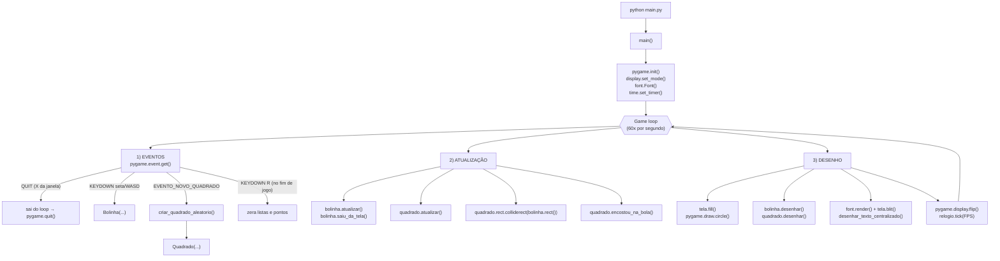

# Bola Atiradora

Jogo simples feito com [pygame](https://www.pygame.org/), criado como projeto de **estudo**.
Este README explica como o jogo funciona por dentro: quais funções existem, quem chama quem
e quais recursos do pygame são usados em cada parte.

## O jogo

Uma bola azul fica parada no centro da tela. A cada 1 segundo, um quadrado nasce em uma das
quatro bordas (sorteada) e anda em linha reta até a bola. O jogador atira bolinhas vermelhas
na direção da tecla pressionada para destruir os quadrados antes que eles cheguem ao centro.

| Tecla | Ação |
|---|---|
| `↑` ou `W` | Atira para cima |
| `↓` ou `S` | Atira para baixo |
| `←` ou `A` | Atira para a esquerda |
| `→` ou `D` | Atira para a direita |
| `R` | Reinicia (na tela de fim de jogo) |

- Cada quadrado destruído vale 1 ponto.
- Se um quadrado encostar na bola central, o jogo acaba.

### Como rodar

```
pip install pygame
python main.py
```

---

## Estrutura do projeto

```
Bola Atiradora/
├── main.py       → inicializa o pygame, cria a janela e roda o loop do jogo
├── bolinha.py    → classe Bolinha (o tiro)
└── quadrado.py   → classe Quadrado (o inimigo) e a função que sorteia onde ele nasce
```

`main.py` é o "maestro": ele **importa** e **usa** os outros dois arquivos.
`bolinha.py` e `quadrado.py` não conhecem um ao outro nem o `main.py`. Cada um só sabe
cuidar de si mesmo (andar, se desenhar, dizer se saiu da tela ou se encostou na bola).

```python
# main.py
from bolinha import Bolinha                     # usada para criar cada tiro
from quadrado import criar_quadrado_aleatorio   # usada para criar cada inimigo
```

---

## Visão geral: quem chama quem



Se o diagrama não aparecer no seu visualizador, a mesma ideia em texto:

```
python main.py
└── main()
    ├── pygame.init()                         prepara o pygame
    ├── pygame.display.set_mode(...)          cria a janela → "tela"
    ├── pygame.display.set_caption(...)       título da janela
    ├── pygame.time.Clock()                   relógio para controlar o FPS
    ├── pygame.font.Font(None, ...)           fontes para os textos
    ├── pygame.time.set_timer(EVENTO_NOVO_QUADRADO, 1000)
    │
    └── while rodando:                        ← GAME LOOP
        ├── 1) EVENTOS: for evento in pygame.event.get()
        │   ├── QUIT                → rodando = False
        │   ├── (fim de jogo) KEYDOWN R → reinicia
        │   ├── KEYDOWN seta/WASD   → Bolinha(centro, raio, direcao)
        │   └── EVENTO_NOVO_QUADRADO→ criar_quadrado_aleatorio()
        │                                └── Quadrado(posicao, direcao)
        │
        ├── 2) ATUALIZAÇÃO (só se não for fim de jogo)
        │   ├── bolinha.atualizar()           para cada bolinha
        │   ├── bolinha.saiu_da_tela()        remove as que saíram
        │   ├── quadrado.atualizar()          para cada quadrado
        │   ├── quadrado.rect.colliderect(bolinha.rect())  → destrói os dois, +1 ponto
        │   └── quadrado.encostou_na_bola()   → fim_de_jogo = True
        │
        └── 3) DESENHO
            ├── tela.fill(BRANCO)             apaga o quadro anterior
            ├── pygame.draw.circle(...)       bola central
            ├── bolinha.desenhar(tela)        → pygame.draw.circle
            ├── quadrado.desenhar(tela)       → pygame.draw.rect
            ├── fonte.render + tela.blit      placar
            ├── desenhar_texto_centralizado() mensagem de fim de jogo
            ├── pygame.display.flip()         mostra o quadro na janela
            └── relogio.tick(FPS)             espera para manter 60 FPS
    pygame.quit()
```

---

## O conceito central: o game loop

Todo jogo em pygame gira em torno de um `while` que se repete muitas vezes por segundo.
Cada volta produz **um quadro** (frame) e sempre faz três coisas, nesta ordem:

1. **Eventos**: lê o que o jogador fez (teclas, mouse, fechar a janela) e os eventos de timer.
2. **Atualização**: muda o estado do jogo (move objetos, testa colisões, decide se acabou).
3. **Desenho**: apaga a tela, desenha tudo na posição nova e mostra o resultado.

O pygame **não guarda** o que foi desenhado como objetos. A tela é só uma imagem. Por isso,
a cada quadro, o jogo pinta tudo de novo do zero. A sensação de movimento vem de redesenhar
os objetos um pouquinho deslocados 60 vezes por segundo.

O `relogio.tick(FPS)` no fim do loop garante que ele não rode mais rápido que 60 voltas por
segundo. Como as velocidades do jogo estão em "pixels por quadro", isso deixa a velocidade
igual em qualquer computador.

---

## `main.py` em detalhe

### Constantes (topo do arquivo)

| Nome | Valor | Para que serve |
|---|---|---|
| `TAMANHO_JANELA` | 600 | Largura e altura da janela (quadrada) |
| `FPS` | 60 | Quadros por segundo |
| `BRANCO`, `AZUL`, `PRETO`, `VERMELHO` | tuplas RGB | Cores, no formato `(vermelho, verde, azul)`, de 0 a 255 |
| `RAIO_CIRCULO` | 40 | Raio da bola central |
| `INTERVALO_QUADRADOS_MS` | 1000 | De quanto em quanto tempo nasce um quadrado (ms) |
| `EVENTO_NOVO_QUADRADO` | `pygame.USEREVENT + 1` | Tipo de evento criado pelo jogo |
| `DIRECOES` | dicionário | Liga cada tecla a uma direção `(x, y)` |

**Sobre `EVENTO_NOVO_QUADRADO`:** os eventos do pygame são identificados por números.
`pygame.USEREVENT` é o primeiro número que o pygame reserva para eventos inventados pelo
programador. Somando 1, criamos um tipo de evento próprio, que depois é disparado pelo timer.

**Sobre `DIRECOES`:** as teclas são identificadas por constantes como `pygame.K_UP` e
`pygame.K_w`. A direção é um par `(x, y)`. Lembre que **no pygame o y cresce para baixo**,
então "para cima" é `(0, -1)`.

### `main()`

É a função que roda o jogo inteiro. Ela é chamada no final do arquivo:

```python
if __name__ == "__main__":
    main()
```

Isso faz `main()` rodar só quando você executa `python main.py` diretamente, e não quando
o arquivo é importado por outro.

#### Preparação (antes do loop)

| Chamada | O que faz |
|---|---|
| `pygame.init()` | Inicializa todos os módulos do pygame. Precisa vir antes de tudo. |
| `pygame.display.set_mode((600, 600))` | Cria a janela e devolve uma **Surface**, a "tela" onde se desenha. |
| `pygame.display.set_caption("Bola Atiradora")` | Define o título da janela. |
| `pygame.time.Clock()` | Cria o relógio usado para limitar o FPS. |
| `pygame.font.Font(None, 72)` | Carrega a fonte padrão do pygame no tamanho 72 (e outra no 32). |
| `pygame.time.set_timer(EVENTO_NOVO_QUADRADO, 1000)` | Pede ao pygame para colocar esse evento na fila a cada 1000 ms, para sempre. |

Também cria o **estado da partida**: as listas `bolinhas` e `quadrados`, o contador `pontos`
e a flag `fim_de_jogo`.

#### 1) Eventos

`pygame.event.get()` devolve a lista de tudo o que aconteceu desde o quadro anterior.
Precisa ser chamado todo quadro: se o jogo parar de ler eventos, o Windows acha que a janela
travou ("Não está respondendo").

O loop trata cada evento assim:

| Evento | Condição | Ação |
|---|---|---|
| `pygame.QUIT` | clicou no X da janela | `rodando = False` (sai do loop) |
| `pygame.KEYDOWN` com `pygame.K_r` | está no fim de jogo | zera `bolinhas`, `quadrados`, `pontos` e `fim_de_jogo` |
| `pygame.KEYDOWN` com tecla em `DIRECOES` | jogo rodando | cria `Bolinha(centro, RAIO_CIRCULO, direcao)` e põe na lista |
| `EVENTO_NOVO_QUADRADO` | jogo rodando | chama `criar_quadrado_aleatorio(TAMANHO_JANELA)` e põe na lista |

`KEYDOWN` acontece **uma única vez** quando a tecla é apertada. Segurar a tecla não gera
novos eventos, por isso cada toque dispara exatamente uma bolinha.

Durante o fim de jogo, o timer continua gerando `EVENTO_NOVO_QUADRADO`, mas o `elif fim_de_jogo:`
captura o evento antes e o ignora.

#### 2) Atualização

Só acontece quando `fim_de_jogo` é `False`. Com o jogo encerrado, nada se mexe.

1. **Move as bolinhas:** chama `bolinha.atualizar()` em cada uma.
2. **Remove bolinhas fora da tela:** reconstrói a lista só com as que `saiu_da_tela()` for `False`.
   Sem isso, a lista cresceria para sempre.
3. **Move os quadrados:** chama `quadrado.atualizar()` em cada um.
4. **Colisão bolinha × quadrado:** para cada par, testa
   `quadrado.rect.colliderect(bolinha.rect())`. Se for `True`, remove os dois e soma 1 ponto.
   O laço externo percorre `quadrados[:]`, uma **cópia** da lista, porque não é seguro remover
   itens de uma lista enquanto se anda por ela.
5. **Fim de jogo:** se algum `quadrado.encostou_na_bola(centro, RAIO_CIRCULO)`, então
   `fim_de_jogo = True`.

#### 3) Desenho

A ordem importa: **o que é desenhado por último fica na frente**.

1. `tela.fill(BRANCO)`: pinta a tela inteira, apagando o quadro anterior.
2. `pygame.draw.circle(tela, AZUL, centro, RAIO_CIRCULO)`: a bola central.
3. `bolinha.desenhar(tela)` para cada bolinha. Elas ficam por cima da bola central.
4. `quadrado.desenhar(tela)` para cada quadrado.
5. Placar: `fonte_pequena.render(...)` cria a imagem do texto e `tela.blit(imagem, (10, 10))`
   a coloca no canto superior esquerdo.
6. Se `fim_de_jogo`: `desenhar_texto_centralizado()` duas vezes, para o título e a instrução.
7. `pygame.display.flip()`: até aqui tudo foi desenhado só na memória. O `flip` mostra o
   quadro pronto na janela de uma vez, o que evita que a tela pisque.
8. `relogio.tick(FPS)`: espera o tempo necessário para manter 60 quadros por segundo.

Ao sair do loop, `pygame.quit()` fecha a janela e libera os recursos do pygame.

### `desenhar_texto_centralizado(tela, fonte, texto, cor, y)`

Chamada por `main()` para escrever as mensagens de fim de jogo. Desenhar texto no pygame
leva três passos:

```python
imagem = fonte.render(texto, True, cor)                         # 1. cria uma Surface com o texto
retangulo = imagem.get_rect(center=(TAMANHO_JANELA // 2, y))    # 2. calcula onde ela fica
tela.blit(imagem, retangulo)                                    # 3. "carimba" na tela
```

- `Font.render(texto, antialias, cor)` **não desenha na tela**. Ele devolve uma nova Surface
  (uma pequena imagem) com o texto. `antialias=True` suaviza as bordas das letras.
- `Surface.get_rect(center=...)` devolve um `Rect` do tamanho da imagem, já posicionado com
  o centro no ponto pedido.
- `Surface.blit(origem, posicao)` copia uma Surface para dentro de outra. A posição pode ser
  uma tupla `(x, y)` ou um `Rect`. Nos dois casos, o pygame usa o canto superior esquerdo.

---

## `bolinha.py` em detalhe

Constantes: `RAIO_BOLINHA = 8`, `VELOCIDADE_BOLINHA = 8` (pixels por quadro) e `COR_BOLINHA`.

### Classe `Bolinha`

Cada tiro na tela é um objeto `Bolinha`, guardado na lista `bolinhas` do `main()`.

| Método | Chamado por | O que faz |
|---|---|---|
| `__init__(centro_bola, raio_bola, direcao)` | `main()`, ao receber `KEYDOWN` | Calcula onde a bolinha nasce e sua velocidade |
| `atualizar()` | `main()`, etapa 2, todo quadro | Soma a velocidade à posição |
| `desenhar(tela)` | `main()`, etapa 3, todo quadro | `pygame.draw.circle(...)` na posição atual |
| `rect()` | `main()`, no teste de colisão | Devolve um `pygame.Rect` em volta da bolinha |
| `saiu_da_tela(largura, altura)` | `main()`, etapa 2 | `True` quando a bolinha inteira passou de uma borda |

**Onde a bolinha nasce:** o centro dela deve ficar no perímetro da bola central:

```python
self.posicao = pygame.math.Vector2(centro_bola) + direcao * raio_bola
```

Partindo do centro `(300, 300)`, com direção para cima `(0, -1)` e raio 40, o resultado é
`(300, 260)`, exatamente na borda de cima da bola azul.

**`pygame.math.Vector2`:** é um par `(x, y)` que aceita contas. Somar dois vetores soma x com x
e y com y. Multiplicar por um número "estica" o vetor. Por isso a velocidade é
`direcao * VELOCIDADE_BOLINHA` e mover é só `self.posicao += self.velocidade`.
O `pygame.draw.circle` aceita um `Vector2` diretamente como centro.

---

## `quadrado.py` em detalhe

Constantes: `LADO_QUADRADO = 30`, `VELOCIDADE_QUADRADO = 2` (pixels por quadro) e `COR_QUADRADO`.

### Função `criar_quadrado_aleatorio(tamanho_janela)`

Chamada por `main()` sempre que chega um `EVENTO_NOVO_QUADRADO`, ou seja, a cada 1 segundo.

1. Monta uma lista de 4 opções, cada uma com (posição inicial, direção). A posição fica no meio
   de uma borda, **logo fora da tela**, e a direção aponta para o lado oposto, rumo ao centro.
2. `random.choice(opcoes)` sorteia uma delas. `random` é do Python, não do pygame.
3. Cria e devolve `Quadrado(posicao, direcao)`.

### Classe `Quadrado`

| Método | Chamado por | O que faz |
|---|---|---|
| `__init__(posicao_inicial, direcao)` | `criar_quadrado_aleatorio()` | Guarda posição e velocidade e cria o `self.rect` |
| `atualizar()` | `main()`, etapa 2, todo quadro | Move a posição e reposiciona o `rect` |
| `desenhar(tela)` | `main()`, etapa 3, todo quadro | `pygame.draw.rect(tela, cor, self.rect)` |
| `encostou_na_bola(centro_bola, raio_bola)` | `main()`, etapa 2 | `True` se o quadrado chegou na bola central |

**Por que `Vector2` e `Rect` ao mesmo tempo?** O `pygame.Rect` só guarda números **inteiros**.
Se a velocidade fosse, por exemplo, 1,5 pixel por quadro, o `Rect` sozinho perderia as casas
decimais e o movimento sairia errado. Por isso a posição "verdadeira" fica no `Vector2` e o
`Rect` só acompanha (`self.rect.center = self.posicao`), servindo para desenhar e para colisões.

**`pygame.Rect(x, y, largura, altura)`:** representa um retângulo, com `(x, y)` sendo o canto
superior esquerdo. Tem atributos para ler e alterar a posição (`.center`, `.top`, `.left`,
`.bottom`...) e métodos de colisão como `colliderect` e `collidepoint`.

**`encostou_na_bola`** usa `Vector2.distance_to()`, que mede a distância em linha reta. Como os
quadrados vêm sempre em linha reta pelos eixos, eles encostam quando a distância entre os
centros fica menor ou igual a `raio_bola + LADO_QUADRADO / 2`.

---

## Colisões: como o jogo sabe que algo encostou

O projeto usa duas técnicas:

| Situação | Técnica | Função usada |
|---|---|---|
| Bolinha × quadrado | Sobreposição de retângulos | `Rect.colliderect()` |
| Quadrado × bola central | Distância entre centros | `Vector2.distance_to()` |

`colliderect` compara dois retângulos. A bolinha é um círculo, então `Bolinha.rect()` cria uma
"caixa" em volta dela. Isso é uma aproximação: nos cantos da caixa não há bolinha de verdade.
Aqui funciona bem porque tudo anda só na horizontal ou na vertical.

---

## Resumo dos recursos do pygame usados

| Recurso | Onde | Para que |
|---|---|---|
| `pygame.init()` / `pygame.quit()` | `main()` | Ligar e desligar o pygame |
| `pygame.display.set_mode()` | `main()` | Criar a janela (Surface principal) |
| `pygame.display.set_caption()` | `main()` | Título da janela |
| `pygame.display.flip()` | `main()` | Mostrar o quadro desenhado |
| `pygame.time.Clock()` / `.tick()` | `main()` | Limitar o FPS |
| `pygame.time.set_timer()` | `main()` | Gerar um evento a cada intervalo |
| `pygame.event.get()` | `main()` | Ler eventos |
| `pygame.QUIT`, `pygame.KEYDOWN` | `main()` | Tipos de evento |
| `pygame.USEREVENT` | `main.py` | Base para eventos próprios |
| `pygame.K_UP`, `K_w`, `K_r`... | `main.py` | Identificar teclas |
| `Surface.fill()` | `main()` | Pintar a tela toda |
| `Surface.blit()` | `main()`, `desenhar_texto_centralizado()` | Colar uma imagem em outra |
| `Surface.get_rect()` | `desenhar_texto_centralizado()` | Rect do tamanho de uma imagem |
| `pygame.draw.circle()` | `main()`, `Bolinha.desenhar()` | Desenhar círculos |
| `pygame.draw.rect()` | `Quadrado.desenhar()` | Desenhar retângulos |
| `pygame.font.Font()` / `.render()` | `main()`, `desenhar_texto_centralizado()` | Escrever textos |
| `pygame.Rect` / `.colliderect()` | `Bolinha`, `Quadrado`, `main()` | Posição retangular e colisão |
| `pygame.math.Vector2` / `.distance_to()` | `Bolinha`, `Quadrado` | Posição, velocidade e distância |
